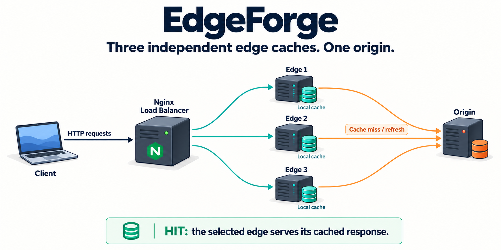
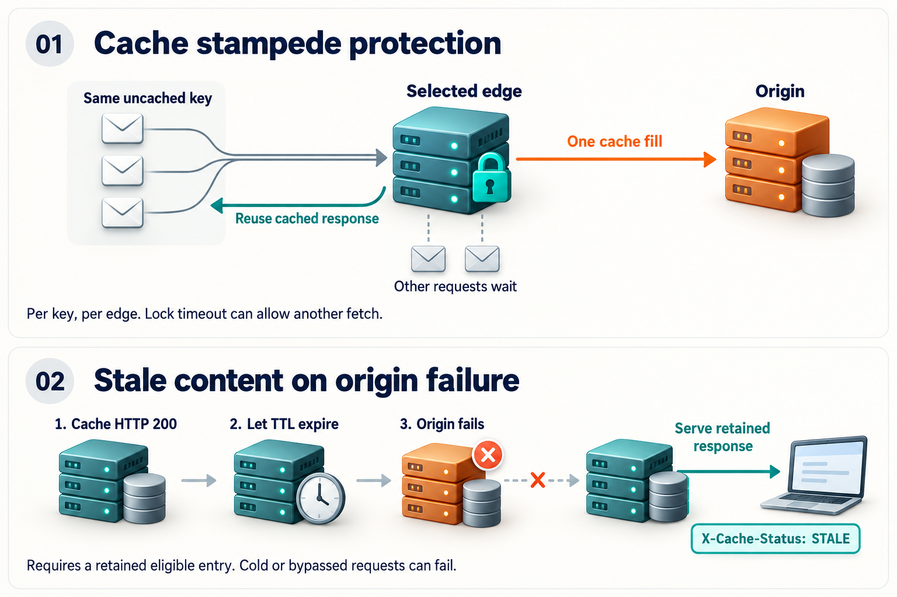

# EdgeForge — CDN Simulator

A containerized Content Delivery Network (CDN) simulator designed to demonstrate HTTP load balancing, edge caching, network latency simulation, and fault tolerance.

Explore the [architecture](#architecture), [cache behavior](#cache-locking-and-stale-fallback), and [validation steps](#local-validation-windows-powershell).

## Project Objectives

- Distribute HTTP requests across three simulated edge servers.
- Cache static content to reduce origin server requests.
- Compare round-robin and least-connections load balancing.
- Configure cache TTL, LRU eviction, and cache bypass.
- Simulate network latency using Python.
- Test edge failure handling and measure CDN performance.
- Deploy the simulator to a single AWS EC2 instance.

## Technology Stack

- Nginx — reverse proxy, load balancing, and caching
- Docker Compose — container orchestration
- Python — network simulation and benchmarking
- AWS EC2 — cloud hosting
- Linux — deployment environment
- Git — version control

## Architecture



The load balancer selects an edge for each request. A cache **HIT** is served
by that edge; a **MISS** fetches from the origin and stores an eligible response.
Each edge maintains its own cache, so warming one edge does not warm the others.

See [Architecture Documentation](docs/architecture.md) for details.

## Run locally

With Docker Compose and Python available, run from the project directory:

```powershell
docker compose up -d
curl.exe -i http://127.0.0.1:8080/
python simulator/load_test.py
```

Inspect `X-Edge-Server` to identify the serving edge and `X-Cache-Status` to
see whether the response used its cache.

## Project Status

**In development — edge caching and origin-failure fallback locally verified.**

Implemented and locally verified:
- Five-container CDN architecture using Docker Compose.
- Nginx reverse proxy and load balancing.
- Independent edge caching with HIT/MISS tracking.
- Cache TTL, expiration, and LRU-based eviction configuration.
- Cache bypass using a request header.
- Cache locking and stale fallback on eligible origin failures.
- Python latency comparison and concurrent load testing.

Upcoming:
- AWS EC2 deployment.
- Performance benchmarking and measured results.

## Deployment Scope

The diagram describes the logical CDN request flow. Docker Compose provides a
cost-conscious development setup; geographic latency is simulated rather than
measured across deployed edge locations.

## Performance Evaluation

The existing Python scripts report response latency, cache hit ratio, and
request distribution. Cache-resilience validation is recorded below; final
performance benchmarking remains planned.

## Edge Caching Strategy

Each edge maintains an independent Nginx disk cache.

Configuration:
- Cache directory: `/var/cache/nginx/cdn`
- Freshness TTL for HTTP 200 responses: 5 minutes
- Target disk cache size: 100 MB per edge
- Inactive entry retention: 10 minutes
- Cache eviction: Nginx cache-manager LRU behavior

Responses expose `X-Edge-Server` and `X-Cache-Status`
headers for troubleshooting and performance evaluation.

Requests containing `X-Bypass-Cache: 1` bypass the existing
cache and prevent the returned response from being stored.

The bypass header is intended for controlled experiments,
not as a production-ready public cache-control policy.

### Cache locking and stale fallback



#### 1. Cache stampede protection

The shared edge configuration enables `proxy_cache_lock on;`. For concurrent
requests for the same uncached key, one request populates that edge's cache;
others wait and can reuse the stored response instead of duplicating origin
fetches. Locks are per key and per edge, so three cold edges can each fetch once.
Bypassed or uncacheable responses do not gain this protection. With Nginx's
default `proxy_cache_lock_timeout 5s`, a waiter that times out fetches from the
origin and does not cache its response. The default `proxy_cache_lock_age 5s`
also permits another origin request if the initial fill is still unfinished.
Locking therefore reduces duplicate fetches without guaranteeing one fetch.

#### 2. Stale content on origin failure

`proxy_cache_use_stale error timeout http_500 http_502 http_503 http_504;`
allows an eligible expired entry to be served with `X-Cache-Status: STALE`
when an origin attempt encounters those failures. The edge must already retain
that key: cold, evicted, or bypassed requests can still fail. HTTP 403/404 are
not selected for stale fallback. A two-second origin connect timeout lets edges
fall back before the load balancer's existing five-second read timeout. An
established but stalled origin response can still outlast that load balancer
timeout. Stale serving does not refresh the entry. There is no separate maximum
stale age configured; existing inactivity and LRU eviction still apply.
After recovery, the next successful origin fetch refreshes the expired entry.

These changes keep the five containers, five-minute TTL, bypass behavior,
100 MB cache limit, ten-minute inactivity setting, and fixed 16-hour roadmap.
See the [Nginx directive reference](https://nginx.org/en/docs/http/ngx_http_proxy_module.html#proxy_cache_lock).

### Local validation (Windows PowerShell)

Start the existing stack and run the existing load test against a new cache key:

```powershell
docker compose up -d
python -c "import time; import simulator.load_test as t; t.URL = 'http://127.0.0.1:8080/index.html?lock=' + str(time.time_ns()); t.run_load_test()"
```

For stale fallback, warm the existing HTTP 200 file on all edges, wait longer
than the unchanged TTL, then stop only the origin. Inspect both response headers
on every request; warm-up must show all three edges and subsequent HITs.
Use GET with `curl.exe` on the host; no HTTP client inside Nginx is required.

```powershell
$cacheTestUrl = "http://127.0.0.1:8080/index.html?stale=$([DateTimeOffset]::UtcNow.ToUnixTimeMilliseconds())"
1..9 | ForEach-Object { curl.exe -sS --max-time 10 -D - -o NUL $cacheTestUrl }
Start-Sleep -Seconds 306
try {
    docker compose stop origin
    1..9 | ForEach-Object { curl.exe -sS --max-time 10 -D - -o NUL $cacheTestUrl }
    curl.exe -sS --max-time 10 -D - -o NUL -H "X-Bypass-Cache: 1" $cacheTestUrl
    curl.exe -sS --max-time 10 -D - -o NUL "${cacheTestUrl}-cold"
} finally {
    docker compose start origin
}
Start-Sleep -Seconds 2
1..9 | ForEach-Object { curl.exe -sS --max-time 10 -D - -o NUL $cacheTestUrl }
curl.exe -sS --max-time 10 -D - -o NUL -H "X-Bypass-Cache: 1" $cacheTestUrl
docker compose ps
```

Expect HTTP 200 STALE for the retained expired key during this stopped-origin
test, but HTTP 502/504 for the bypassed and cold requests. After origin startup,
expect HTTP 200 EXPIRED then HIT on each edge, and HTTP 200 BYPASS. Repeat the
recovery requests if the origin is still starting.

Validation: the existing 100-request/10-worker load test returned 100 HTTP 200
responses (3 MISS, 97 HIT); origin logs contained three GETs for that cold key.
After the real TTL expired, the stopped-origin test returned 9/9 HTTP 200 STALE
responses with the original body across all edges. Cold and bypassed requests
returned HTTP 504. Restoring the origin restored HTTP 200 HIT/BYPASS behavior.
The first outage attempt hit the client timeout; adding the two-second edge
connect timeout resolved that case. Lock timeout/age and individual HTTP 5xx
fallback cases were not fault-injected; this is not a performance comparison.

**Preliminary local performance results**

Using `127.0.0.1:8080`, an initial benchmark with 10 verified HIT and 10 verified BYPASS samples measured:

- Average Cache HIT latency: **19.492 ms**
- Average Cache BYPASS latency: **43.565 ms**
- Observed reduction in average response time: **55.26%**

A subsequent run reported a **56.71% reduction**, suggesting a similar relative improvement under that test, although the complete timing details were not retained.

These are preliminary local measurements, not final benchmark claims. The earlier high timings obtained through `localhost` improved substantially after changing the endpoint to `127.0.0.1`. The precise cause has not been confirmed.

Final reproducible performance results will be collected on Day 7.
